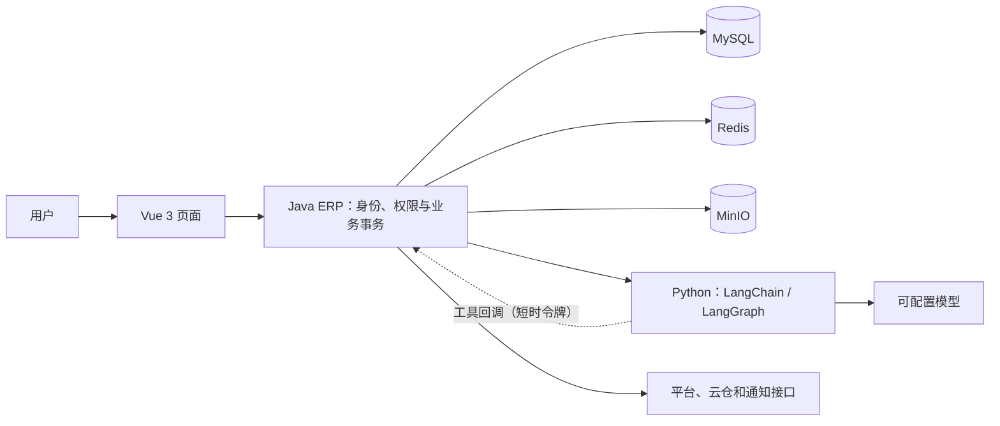
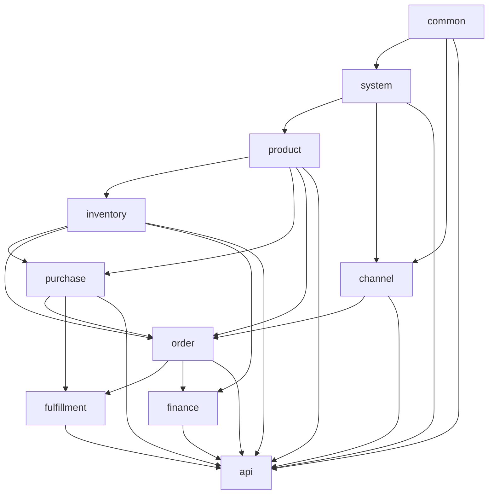

# 系统架构

项目是前后端分离的**模块化单体（Modular Monolith）**：`erp-frontend` 独立运行，Java 后端只有 `erp-api` 一个进程、内部按业务领域拆分为 10 个 Maven 模块；Python AI 服务独立运行。

## 模块划分

后端代码位于 `erp-backend/`，按业务领域拆分，实体/数据访问/服务/接口都内聚在各自模块内（`cn.xinghuaerp.<module>.*`）。

| 模块 | 包 | 职责 |
| --- | --- | --- |
| `erp-common` | `cn.xinghuaerp.common`、`cn.xinghuaerp.json` | 技术基座：统一结果、异常、分页、常量、工具、缓存与通用配置；Jackson 3 JSON 工具。 |
| `erp-system` | `cn.xinghuaerp.system` | 系统与主数据：用户、角色、权限、字典、配置、商户、店铺；认证授权（JWT、登录）。 |
| `erp-product` | `cn.xinghuaerp.product` | 商品中心：SPU、SKU、类目、品牌、店铺商品、供应商商品明细与报价。 |
| `erp-channel` | `cn.xinghuaerp.open`、`cn.xinghuaerp.platform` | 渠道接入：外部平台 API SDK（淘宝/京东/拼多多/抖音/快手/小红书等）+ 平台授权与店铺平台参数（OAuth、Token）。 |
| `erp-order` | `cn.xinghuaerp.order` | 订单：订单同步、订单处理、售后、退款；AI 销售/风险/营销数据聚合。 |
| `erp-fulfillment` | `cn.xinghuaerp.fulfillment` | 履约：发货、物流、电子面单、供应商代发。 |
| `erp-inventory` | `cn.xinghuaerp.inventory` | 库存：仓库、库存、出入库、备货、库存锁定与调拨；AI 库存审核数据聚合。 |
| `erp-purchase` | `cn.xinghuaerp.purchase` | 采购：采购单、采购入库、供应商及其货品；AI 采购草稿数据聚合。 |
| `erp-finance` | `cn.xinghuaerp.finance`、`cn.xinghuaerp.report` | 财务与报表：成本、结算、费用、账本；仪表盘、经营统计。 |
| `erp-api` | `cn.xinghuaerp.erp`、`cn.xinghuaerp.ai` | 启动与组装：全局配置、跨模块编排控制器、MQ 与定时任务；AI 控制器、工具网关与跨模块只读视图。 |

## 模块依赖方向

模块间是单向依赖（无环），下层被上层依赖；`erp-api` 是唯一组装层，依赖全部业务模块。

## 模块交互

- 跨模块只能通过各模块的 **Facade 接口**（`cn.xinghuaerp.<module>.facade`，如 `InventoryFacade`、`OrderFacade`、`ProductFacade`）访问，禁止直接注入其它模块的 `Mapper` 或直接修改其数据表。
- 模块内部独立管理自己的数据表；核心业务优先本地事务，跨模块流程通过 RabbitMQ 事件协调（订单域已有 `OrderCreatedEvent` 等）。
- `erp-common` 只放基础组件，避免承载业务以造成循环依赖。
- 跨模块的横切关注点（如业务主体数据范围解析）通过系统域定义的 SPI（`BusinessSubjectValidator`）由各业务模块实现回调，避免系统域反向依赖业务域。

## 入口

- 启动与配置：[ErpApi](../erp-backend/erp-api/src/main/java/cn/xinghuaerp/erp/ErpApi.java)、[application.yml](../erp-backend/erp-api/src/main/resources/application.yml)、[Docker Compose](../docker/docker-compose.yml)（编排与配置映射见 [docker/README](../docker/README.md)）。
- 认证授权：[SecurityConfig](../erp-backend/erp-system/src/main/java/cn/xinghuaerp/system/security/SecurityConfig.java)。
- 业务接口与实现：各模块的 `controller`、`service`、`facade` 子包。
- 前端请求与路由：[request.ts](../erp-frontend/src/utils/request.ts)、[路由守卫](../erp-frontend/src/permission.ts)。
- 业务操作见[采购销售库存业务流程](采购销售库存业务流程.md)，AI 架构与职责边界见[AI 智能体说明](AI智能体说明.md)。

技术栈：前端 Vue 3、TypeScript、Vite、Element Plus；后端 Spring Boot 4.1.0、Java 21、MyBatis-Plus 3.5.x、Jackson 3；AI 服务 Python 3.11+、FastAPI、LangChain / LangGraph（Java 侧不含模型客户端）。MySQL 保存业务和权限数据，Redis 保存登录态与缓存，MinIO 保存图片。外部平台、云仓与通知能力以对应平台的授权和配置为准。
